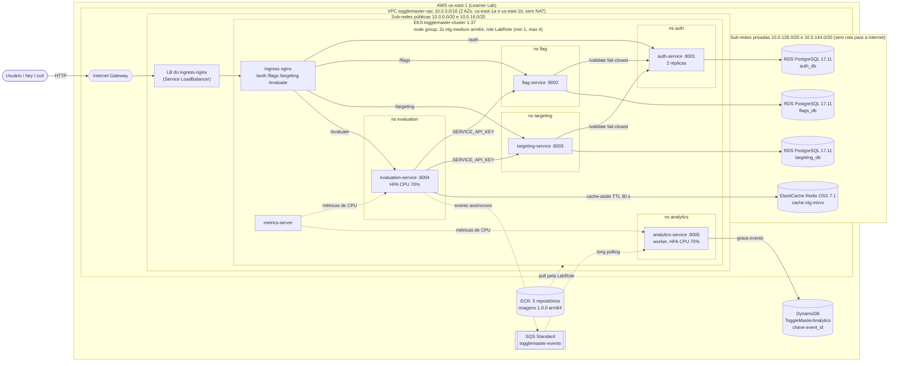

# Arquitetura do ToggleMaster na AWS (Fase 2)

> RASCUNHO redigido pelo Claude em 2026-11-03, a pedido do Nycolas, para revisão.
> Versão em imagem: [`arquitetura.svg`](arquitetura.svg).

## Siglas

- **AWS**: Amazon Web Services.
- **VPC**: Virtual Private Cloud, a rede privada da conta.
- **AZ**: Availability Zone, um datacenter isolado dentro da região.
- **NAT**: Network Address Translation, saída para a internet a partir de sub-rede privada (não usado).
- **EKS**: Elastic Kubernetes Service, o Kubernetes gerenciado.
- **ECR**: Elastic Container Registry, o registro de imagens.
- **RDS**: Relational Database Service, aqui PostgreSQL gerenciado.
- **SQS**: Simple Queue Service, a fila de mensagens.
- **LB**: Load Balancer, o balanceador de carga.
- **HPA**: Horizontal Pod Autoscaler, que escala pods por métrica.
- **KEDA**: Kubernetes Event-driven Autoscaling.
- **IMDS**: Instance Metadata Service, que entrega as credenciais da role à instância.
- **TTL**: Time To Live, tempo de vida de uma entrada no cache.

## Diagrama

## Legenda

- Seta cheia: chamada síncrona (HTTP ou protocolo do banco).
- Seta pontilhada: fluxo assíncrono (fila), pull de imagem ou coleta de métricas.
- `ns`: namespace do Kubernetes. Cada serviço tem o seu (Deployment, Service ClusterIP, ConfigMap e Secret).
- SQS, DynamoDB e ECR são serviços regionais da AWS, fora da VPC. Os nós os alcançam pelo Internet Gateway.

## Decisões

| Decisão | Por quê | Alternativa descartada |
|---|---|---|
| **VPC própria, sem NAT** | Bancos em sub-redes privadas, sem rota para a internet (defesa em profundidade). Nós e LB nas públicas, com IP público, para alcançar ECR, SQS e DynamoDB sem pagar NAT. | VPC padrão (bancos em sub-rede com rota para a internet); nós em sub-rede privada com NAT Gateway (custo por hora). |
| **arm64 com nós Graviton `t4g`** | A imagem do cluster é a mesma testada no compose (o build no Mac Apple Silicon sai arm64). Também é cerca de 20% mais barato. | Imagens amd64 via `docker buildx --platform linux/amd64` e nós `t3`. |
| **Um namespace por serviço** | O PDF pede separar por namespace. Cada Secret fica isolado: o flag não enxerga a senha do RDS do auth. A comunicação entre serviços usa o DNS completo (`auth-service.auth.svc.cluster.local`). | Um namespace único para tudo. |
| **Credenciais AWS pela LabRole (IMDS)** | evaluation (SQS) e analytics (SQS, DynamoDB) usam a role do node group. Os SDKs renovam as credenciais sozinhos, e nenhuma chave fica em Secret. | Chaves temporárias do lab no Secret, que expiram a cada sessão. |
| **HPA por CPU no lugar do KEDA** | No AWS Academy o IAM é limitado (sem IRSA), e o KEDA precisaria de permissão para ler a fila. Com a fila cheia, o analytics processa mais, a CPU sobe e o HPA escala. | KEDA com ScaledObject na profundidade da fila (Opção B, conta pessoal). |
| **Redis sem criptografia em trânsito** | O cliente `go-redis` do evaluation conecta com `redis://`. O tráfego não sai da VPC e é restrito pelo security group. | `rediss://` com TLS, que exigiria mudança no código. |

### Propósito de cada data store

- **RDS PostgreSQL**: dados relacionais e transacionais com esquema (chaves de API, flags, regras de segmentação). Precisa de consistência forte e consultas SQL. É um banco por serviço (database per service).
- **ElastiCache Redis**: cache em memória do caminho quente `/evaluate`. A leitura sai em microssegundos e o TTL de 30 s alivia flag, targeting e os RDS. Os dados são descartáveis: se o cache cair, o serviço busca na origem.
- **DynamoDB**: grava eventos de analytics em alto volume, só com acréscimo, por chave (`event_id`). É serverless, sob demanda, escala sem gerenciar instância e dispensa esquema fixo.
